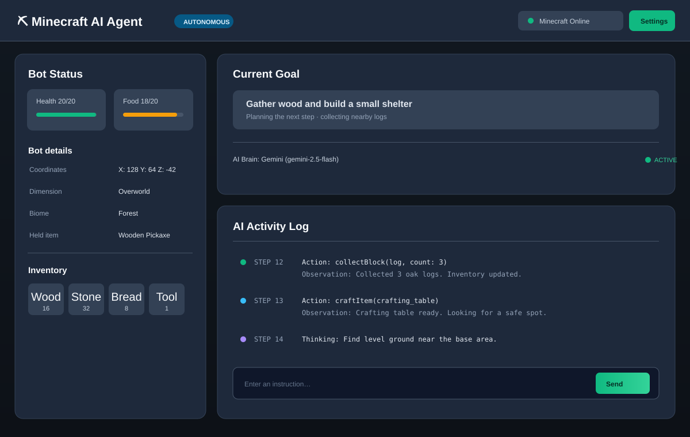

# BlockWhiz — Minecraftで自律的に動くAIボットを、あなたのPCで。

[](https://github.com/kurageno8156-lgtm/craftmate-payload/releases/latest)
[]()
[](LICENSE)

**BlockWhiz** は、Google Gemini / OpenAI / Groq / Ollama などのAIと連携し、**Minecraft Java Edition の世界で建築・採掘・探索・戦闘・会話を自律的に実行する Windows アプリ**です。

「家を建てて」「鉄のツルハシを作って」「このモンスターを倒して」と自然な言葉で指示するだけで、AIが状況を判断し、必要な素材集めから道具作り、設計図の生成と建築まで自分で進めます。進行状況はブラウザのダッシュボードでリアルタイムに確認できます。



---

## ⬇️ ダウンロード

**[最新版 v1.3.133 をダウンロード (CraftMate_Setup.exe)](https://github.com/kurageno8156-lgtm/craftmate-payload/releases/latest/download/CraftMate_Setup.exe)**

> 常に最新リリースがダウンロードされます。過去のバージョンは [Releases](https://github.com/kurageno8156-lgtm/craftmate-payload/releases) ページから取得できます。

---

## ✨ 主な機能

- **🧠 自律行動（ReActループ）** — 「目標 → 状況認識 → 計画 → 実行 → 観察」を繰り返し、失敗したら自分で方法を変えて再試行します
- **🏗️ 建築** — AIが設計図を自動生成し、コマンドブロック一括建築または手作業で家や建物を建てます
- **⛏️ 採掘・クラフト** — 木・石・鉄鉱石の採掘、作業台・ツルハシ・剣などのレシピ解決クラフトを自動化
- **⚔️ 戦闘・生存** — モブ討伐、動物の狩り、食料確保、自動防御ガード、満腹度管理
- **💬 自然な会話** — Minecraftチャットから直接話しかけ可能。雑談・質問にも応答し、過去のやり取りを記憶します
- **🖥️ 見える化ダッシュボード** — 体力・満腹度・インベントリ・周囲エンティティ・AI思考ログをリアルタイム表示。クイックコマンド対応
- **🗂️ チャットルーム** — 会話をルームごとに整理。履歴はローカルDBに永続化
- **📺 画面共有** — ボットの一人称視点をブラウザで確認可能
- **🔄 アプリ内アップデーター** — ワンクリックで最新版に更新。更新後は自動再起動
- **🔌 AIモデル切替** — Gemini / OpenAI / Groq / Ollama（ローカル・無料）を設定画面から切替

---

## 💻 システム要件

| 項目 | 要件 |
|---|---|
| OS | Windows 10 / 11（64bit） |
| Node.js | **不要**（インストーラーに同梱） |
| Minecraft | Java Edition **1.20.5 〜 1.21.11 推奨**（その他も自動検出・手動選択可） |
| AI | Gemini / Groq / OpenAI の APIキー、またはローカル Ollama |

---

## 🖥️ 対応プラットフォーム

| プラットフォーム | ステータス | 配布形式 | 備考 |
|---|---|---|---|
| **Windows** (x64 / x86 / ARM64) | ✅ **利用可能** | `CraftMate_Setup.exe` | Node.js同梱・完全ポータブル |
| Linux (x64 / ARM64) | ✅ **利用可能** | `CraftMate-linux-{x64,arm64}.AppImage` / `.deb` / `.tar.gz` | Electronデスクトップアプリ＋ポータブルtarball |
| macOS (Intel / Apple Silicon) | ✅ **利用可能** | `CraftMate-macos-{arm64,x64}.dmg` | 署名・公証なし（後述の手順で起動） |
| Android | 💭 検討中 | APK / Google Play 検討 | Minecraft PE 連携が前提 |
| iOS | 💭 検討中 | App Store / TestFlight 検討 | 同上 |

> **モバイルをお使いの方へ**: Android / iOS 版は検討中です。

### macOS 版の起動方法

1. `CraftMate-macos-arm64.dmg`（Apple Silicon）または `CraftMate-macos-x64.dmg`（Intel）をダウンロードして開く
2. `BlockWhiz` を `Applications` フォルダへドラッグ＆ドロップ
3. 初回起動時、Gatekeeper により「壊れている可能性があるため開けません」と表示される場合があります（署名・公証を行っていないため）。その場合は：
   - **Finder で BlockWhiz を Control + クリック →「開く」→ ダイアログの「開く」**
   - または `システム設定 → プライバシーとセキュリティ →「このまま開く」`
4. 以降は通常通り起動できます

### Linux 版の起動方法

**デスクトップアプリ（推奨）— AppImage / deb**

```bash
# AppImage: 実行権限を付けて起動（アプリメニュー登録は deb 版のみ）
chmod +x CraftMate-linux-x64.AppImage
./CraftMate-linux-x64.AppImage

# または deb をインストール → アプリメニューの「BlockWhiz」から起動（x64のみ）
sudo apt install ./CraftMate-linux-x64.deb
```

> ARM64 版は AppImage のみ提供（deb は x64 のみ）。

Electron ラッパーがサーバー（`dist/index.js`）をバックグラウンドで起動し、`http://localhost:3000` をネイティブウィンドウに表示します。ウィンドウを閉じるとサーバープロセスも自動終了します。

**ポータブル tarball（従来版）**

```bash
tar xzf craftmate-linux-x64.tar.gz
cd craftmate-linux-x64
chmod +x start.sh
./start.sh   # ブラウザで http://localhost:3000 を開く
```

> Linux 版は C# 製ランチャー/アップデーターを使いません。in-app アップデーターは Windows 版のみ対応しています。

---

## 📦 インストール方法

1. **[CraftMate_Setup.exe](https://github.com/kurageno8156-lgtm/craftmate-payload/releases/latest/download/CraftMate_Setup.exe)** をダウンロードして実行
2. デスクトップに作成されるショートカットから **BlockWhiz** を起動
3. 設定画面（⚙️）で AI プロバイダーと API キーを設定 → Minecraftワールドにボットが参加

セットアップは以上です。アンインストールは Windows の「アプリと機能」または `Uninstall.exe` から行えます。

---

## 🔒 セキュリティとプライバシー

- **APIキーはローカルの `.env` にのみ保存**され、BlockWhizのサーバーや外部に送信・公開されることはありません
- チャット履歴・AIメモリ・レビューは `%LOCALAPPDATA%\CraftMate\craftmate.db`（SQLite）にローカル保存
- ダッシュボードは `127.0.0.1:3000` のみで待ち受け、外部からのアクセスは遮断されます
- アップデート等のローカル操作APIは認証ガードで保護されています

---

## ❓ トラブルシューティング（FAQ）

**Q. 「サーバーが応答しません」と表示される**
A. v1.3.131 以降、サーバーの自己診断ウォッチドッグが組み込まれており、HTTP応答が止まった場合は約45秒で自動再起動します。ログは `%TEMP%\CraftMate_server.log` に記録されます。

**Q. Minecraftに接続できない**
A. Minecraftのワールドが起動しているか確認してください。シングルプレイの場合は「LANに公開」を有効にして表示されたポートを設定に入力。サーバーの場合はポート25565とファイアウォールを確認してください。

**Q. ブラウザを閉じたら裏でプロセスが残る**
A. v1.3.131 以降、ブラウザ終了を検知して関連プロセスを自動終了します（ボットがMinecraft接続中を除く）。確実に終了するには設定画面の「⏻ アプリを完全に終了」ボタンを使ってください。

**Q. アンインストール方法は？**
A. まず「⏻ アプリを完全に終了」でプロセスを停止し、Windows の「アプリと機能」から BlockWhiz を削除するか、`Uninstall.exe` を実行してください。

**Q. 建築が途中で止まる**
A. v1.3.132 以降、設計図が無くてもフォールバック設計図で建築を継続し、コマンドブロック設置のタイムアウトにはリトライ＋`/setblock`フォールバックがあります。建築は1ブロックずつ設置するため時間がかかるのが正常です。

**Q. 「WindowsによってPCが保護されました」（SmartScreen警告）が出る**
A. `CraftMate_Setup.exe` はコード署名を行っていないため、初回起動時にSmartScreenの警告が表示されます。対処法:

1. 「**詳細情報**」をクリック
2. 「**実行**」をクリック
3. UAC（ユーザーアカウント制御）で「**はい**」

BlockWhizはあなたのPC上でのみ動作し、APIキー等の情報を外部に送信しません。コード署名証明書を導入すればこの警告は解消されます（後述「コード署名」を参照）。

**Q. アップデートはどうやって適用されますか？**
A. ダッシュボード上部に新バージョンの通知バーが表示されたら「今すぐ更新」を押してください。Windows版はアプリ内アップデーターが自動でダウンロード・適用します。Linux版 **AppImage** もアプリ内からダウンロード→SHA256検証→自動置換→再起動まで行えます（deb / tarball 版は手動更新）。設定画面の「↻ アップデートを確認」からも同じ手順で更新できます。

---

## 🔏 コード署名（SmartScreen警告の解消）

SmartScreen警告を根本的に解消するには、信頼されたCA発行のコード署名証明書が必要です。

### 証明書の取得

- **OV証明書**（例: SSL.com, Sectigo, DigiCert）: 年間数万円程度。署名後、SmartScreenの評判が貯まるにつれ警告が出にくくなります。
- **EV証明書**: 即座にSmartScreen警告が出なくなりますが高価です。

### 署名付きビルド方法

1. 証明書を `.pfx` 形式でエクスポート
2. ビルド環境に以下を設定:

```powershell
$env:CRAFTMATE_PFX_PATH = "C:\path\to\cert.pfx"
$env:CRAFTMATE_PFX_PASSWORD = "your-password"   # パスワードなしなら省略可
# または $env:CRAFTMATE_PFX_BASE64 = "<base64エンコードしたpfx>"  # CI用
```

3. `installer/Build-Release.ps1` が自動的に `signtool.exe`（Windows SDK同梱）で `CraftMate.exe` / `Launcher.exe` / `CraftMate_Updater.exe` / `Uninstall.exe` / `CraftMate_Setup.exe` を署名します。GitHub Actions のシークレット `CRAFTMATE_PFX_BASE64` / `CRAFTMATE_PFX_PASSWORD` に設定すればCIでも署名されます。

> ⚠️ 自己署名証明書ではSmartScreen警告は解消されません（警告が「発行元不明」から変わるだけです）。必ず公的CA発行の証明書を使用してください。

---

## 🔐 ログイン認証（OAuth 2.0 / OpenID Connect）

v1.3.157 以降、初回起動時にログイン画面が表示されます。ユーザーは「Googleでログイン」「GitHubでログイン」「Discordでログイン」ボタンを押すだけで、各プロバイダの標準ログイン画面に遷移して認証できます。セッションは AES-256-GCM で暗号化してローカルに保存され、次回起動時は自動ログインされます。

### OAuth アプリの登録（開発者向け）

ボタン1つでログインできるようにするには、各プロバイダで OAuth アプリを登録し、Client ID / Client Secret を `oauth-clients.json`（ローカルビルド）または GitHub Secrets（CI ビルド：`GOOGLE_CLIENT_ID` / `GOOGLE_CLIENT_SECRET` 等）に設定してください。リダイレクト URI は以下を全プロバイダ共通で登録します:

```
http://127.0.0.1:3000/api/integrations/<provider>/oauth/callback
```

`<provider>` は `google` / `github` / `discord` のいずれかです（プロバイダごとに個別のURIを登録）。

#### Google

1. [Google Cloud Console](https://console.cloud.google.com/) でプロジェクトを作成
2. 「APIとサービス」→「OAuth同意画面」でユーザータイプ（外部/内部）とスコープ（`openid`, `email`, `profile`）を設定
3. **アプリのロゴを設定**（Google のログイン画面に BlockWhiz アイコンを表示するには必須）:
   - 「OAuth同意画面」→「ブランディング」（旧: アプリの情報）の「アプリのロゴをアップロード」で画像を選択
   - 使用する画像: リポジトリの `public/icon-512.png`（512x512 PNG。`app.ico` は ICO 形式のため使えません。PNG/JPG のみ対応）
   - アップロード後、Google の審査（数分〜数日）を経てログイン画面にアイコンが表示されます
   - ※ ロゴ未設定でもログイン自体は動作しますが、同意画面にアイコンが表示されず信頼性が下がります
4. 「認証情報」→「認証情報を作成」→「OAuthクライアントID」→ アプリの種類は「ウェブアプリケーション」
5. 承認済みリダイレクトURIに `http://127.0.0.1:3000/api/integrations/google/oauth/callback` を追加
6. 発行された Client ID / Client Secret を `oauth-clients.json` の `google` セクションに記入
7. **テストユーザーの確認（重要）**: OAuth 同意画面の公開ステータスが「テスト」の場合、登録済みテストユーザー以外はログインできません。
   - Google Cloud Console →「APIとサービス」→「OAuth同意画面」→「対象」→「テストユーザー」に、ログインに使う Gmail アドレスを追加
   - 追加しないと `access_denied` エラー（「このアカウントはテストユーザーに登録されていない可能性があります」と表示）になります
   - 本番公開する場合は「対象」→「公開」を選択（`openid email profile` スコープのみなら審査は通常不要）

#### GitHub

1. GitHub → Settings → Developer settings → **OAuth Apps** →「New OAuth App」
2. Application name（例: BlockWhiz）を入力
3. Homepage URL（任意、例: リポジトリURL）
4. **Authorization callback URL** に `http://127.0.0.1:3000/api/integrations/github/oauth/callback` を設定
5. 「Register application」後、**Client ID** を控える
6. ページ下部「Generate a new client secret」でシークレットを発行
7. 必要なスコープは `read:user` + `user:email` のみ（本アプリが自動要求。過剰な権限は要求しません）

> GitHub OAuth Apps は OpenID Connect の ID トークンを発行しません。BlockWhiz はアクセストークンで `api.github.com/user` と `/user/emails` を呼び出してユーザー情報を取得します。

#### Discord

1. [Discord Developer Portal](https://discord.com/developers/applications) →「New Application」でアプリを作成
2. 左メニュー「OAuth2」→「Redirects」に `http://127.0.0.1:3000/api/integrations/discord/oauth/callback` を追加
3. 同じ「OAuth2」ページの「Client Information」にある **Client ID** と **Client Secret**（「Reset Secret」で発行）を控える
4. 本アプリが要求するスコープは `identify email`（ユーザーID・ユーザー名・メールアドレス取得に必要な最小限）
5. `oauth-clients.json` の `discord` セクションに記入（または GitHub Secrets に `DISCORD_CLIENT_ID` / `DISCORD_CLIENT_SECRET` を設定）

### クライアント情報の設定（ユーザー配置方式）

**配布物（インストーラー / `app_payload.zip` / Linux tarball）には Client Secret を一切含めません。** OAuth を使うには、各ユーザーが自分で OAuth アプリを登録し、認証情報をローカルの設定ファイルに配置してください。

テンプレート（`oauth-clients.example.json`）をコピーして Client ID / Secret を記入します:

```json
{
  "google":    { "clientId": "xxxxx.apps.googleusercontent.com", "clientSecret": "GOCSPX-xxxxx" },
  "github":    { "clientId": "xxxxx", "clientSecret": "xxxxx" },
  "discord":   { "clientId": "xxxxxxxxxxxxxxxxxx", "clientSecret": "xxxxx" }
}
```

**配置場所**（見つかった最初のファイルが使われます）:

- `%LOCALAPPDATA%\CraftMate\oauth-clients.json`（Windows・推奨）
- `$XDG_CONFIG_HOME/craftmate/oauth-clients.json` または `~/.config/craftmate/oauth-clients.json`（Linux/macOS）

実行時の環境変数（`.env.example` 参照）でも設定できます。優先順位は **環境変数 > oauth-clients.json** です。

| 変数 | 用途 |
|---|---|
| `GOOGLE_CLIENT_ID` / `GOOGLE_CLIENT_SECRET` | Google OAuth |
| `GITHUB_CLIENT_ID` / `GITHUB_CLIENT_SECRET` | GitHub OAuth |
| `DISCORD_CLIENT_ID` / `DISCORD_CLIENT_SECRET` | Discord OAuth |
| `OAUTH_ENCRYPTION_KEY` | トークン暗号化鍵（32バイト hex64文字 または base64）。未設定時は `integrations.key` ファイルを使用 |
| `OAUTH_SESSION_SECRET` | `OAUTH_ENCRYPTION_KEY` 未設定時の代替秘密文字列（SHA-256で鍵導出） |

> **開発者向け**: リポジトリルートに `oauth-clients.json` を置くと `npm start` 等の開発実行で読み込まれます（`.gitignore` 済み・コミット禁止）。ただしリリースビルドでは同梱されません。

起動時に `%TEMP%\CraftMate_server.log` の `oauth-clients:` 行で、どのファイルが読み込まれたか確認できます。

Client ID が未設定のプロバイダは、ログインボタンに「未設定」バッジが表示され、押すとプロバイダ別の日本語メッセージ（例: 「Google のOAuthが設定されていません。Google Cloud Console でOAuthクライアントを登録する必要があります。」）が表示されます。設定済みプロバイダには「設定済み」バッジが付きます。

#### 外部アカウント連携のセキュリティ

- **state パラメータ**で CSRF を防止（コールバックで厳密照合）
- **PKCE (S256)** で認可コード横取りを防止
- **OIDC nonce** でリプレイトークンを検証（Google。GitHub / Discord は id_token を発行しない構成のため対象外）
- **ID トークンは JWKS で署名検証**し、issuer・audience・有効期限・nonce を検証（`jose` ライブラリ使用）
- GitHub は ID トークン非対応のため、`api.github.com/user` + `/user/emails` で `provider_user_id`（数値ID）を取得して紐付け
- 連携情報は `external_identities` テーブルに `provider` / `provider_user_id` / `display_name` / `email` / `connected_at` / `updated_at` として記録。**メールアドレス一致による自動アカウント統合は行いません**
- **外部アカウントの所有権は保護されます**: 同じ外部アカウントを別の BlockWhiz ユーザーが連携しようとすると拒否され、既存の所有者情報は上書きされません（DB 制約＋アプリ側チェックの二重防御）
- **ログインは所有者アカウントに解決されます**: 連携済みの外部ID（例: Google でログイン後に連携した GitHub）でログインすると、`external_identities` の所有者である BlockWhiz アカウントに入ります。未連携の外部IDは新規アカウントとして扱われ、既存アカウントに勝手に紐付きません
- トークンは AES-256-GCM で暗号化して SQLite に保存。鍵は `OAUTH_ENCRYPTION_KEY` 環境変数または `integrations.key` ファイル
- **アクセストークンは自動更新されます**: `refresh_token` を持つプロバイダ（Google / Discord、expiring tokens 有効時の GitHub）は期限切れ60秒前に自動で更新し、暗号化して保存します。更新失敗時は再認証が要求されます。GitHub OAuth Apps は通常 `refresh_token` を発行しないため自動更新対象外です
- アクセストークン・シークレット・リフレッシュトークンはログに出力しません

#### 内部アカウント（OAuth フォールバック）

OAuth プロバイダが使えない場合でもログインできるよう、ログイン画面の下部に **内部アカウント** の作成・ログインフォームがあります。

- ユーザー名（3〜32文字の英数字・`_`・`-`）とパスワード（8文字以上）でアカウントを作成
- アカウント情報は `%LOCALAPPDATA%\CraftMate\craftmate.db` の `local_users` テーブルに保存され、パスワードは **scrypt** でハッシュ化されます
- セッションは OAuth ログインと同じ AES-256-GCM 暗号化ストア（`__auth_session`）で管理され、次回起動時に自動ログインされます
- 内部アカウントはローカルPC専用です。複数PC間での同期はありません

#### 実機ログインテストの手順

1. 各プロバイダで OAuth アプリを登録し、Redirect URI に `http://127.0.0.1:3000/api/integrations/<provider>/oauth/callback` を設定（provider = `google` / `github` / `discord`）
2. Client ID / Secret を環境変数または `oauth-clients.json` に設定してアプリを起動
3. ログイン画面で対象プロバイダのボタンを押し、「設定済み」バッジが付いていることを確認
4. 認証ページでアカウントを選択・許可し、完了ページが表示されたらダッシュボードに自動遷移することを確認
5. ダッシュボードの外部アカウント連携で、ログインに使ったプロバイダが「接続済み」になっていることを確認
6. 別のプロバイダでもログインし、`external_identities` テーブルに複数プロバイダが記録されることを確認（`craftmate.db` を DB ブラウザで参照）
7. ログアウト後に `/api/auth/status` が `authenticated:false` を返すことを確認

> **注意**: GitHub OAuth Apps は ID トークン・リフレッシュトークンを通常発行しません。トークン失効・手動 revoke 時は再連携が必要です。Google / Discord は `offline_access` / `access_type=offline` によりリフレッシュトークンを取得し、アクセストークンは期限切れ前に自動更新されます（セッションも維持されます）。

### 配布サイトのレビュー・お問い合わせ

- **レビュー**: GitHub Issues API から公開 Issue のコメントを取得し、**閲覧専用の一覧**として表示します（サイト上に投稿フォームはありません。新規レビューは GitHub リポジトリの Issue から投稿できます）。固定メールアドレスへの送信はありません
- **お問い合わせ**: 静的ホスティング（GitHub Pages）ではサーバー API が使えないため **FormSubmit**（`https://formsubmit.co/ajax/kurageno8156@gmail.com`）経由で `kurageno8156@gmail.com` にメール送信します。メーラーは起動せず、サイト上で送信完了まで完結します
  - **初回送信時**: FormSubmit から `kurageno8156@gmail.com` 宛にアクティベーションメールが届きます。メール内のリンクをクリックすると以降の送信が有効になります。アクティベーション未完了の場合はサイト上にその旨の案内が表示されます
  - 別サービスに切り替える場合は `public/distribution.js` の `FORMSUBMIT_ENDPOINT` を変更してください

---

## 🧱 Minecraft統合版（Bedrock Edition）対応 — BlockWhiz Bedrock アドオン

v1.5.0 以降、統合版向け機能は **`bedrock-app/` のゲーム内アドオン「BlockWhiz Bedrock」** として提供されます。Java 版 BlockWhiz（このリポジトリのデスクトップアプリ）とは完全に独立しており、Mineflayer / Node.js サーバーは使用しません。

### 仕組み

- **ビヘイビアパック + リソースパックのアドオン**（`.mcaddon`）を Minecraft 統合版にインポートするだけで動作
- ゲーム内スクリプト（`@minecraft/server` Script API）がチャットコマンドを処理
- **LAN ポート不使用・シングルプレイ（オフライン）対応**・ダッシュボード不要・外部通信なし
- リソースパックが HUD 左上に「BlockWhiz Bedrock」ステータスを表示

### 使い方

1. `bedrock-app/dist/CraftMate-Bedrock.mcaddon` をダウンロード（GitHub Releases の `CraftMate-Bedrock.mcaddon` アセット、または `node bedrock-app/build.mjs` でビルド）
2. Minecraft 統合版にドラッグ＆ドロップ → ワールドの「ビヘイビアパック」「リソースパック」両方で有効化
3. ゲーム内チャットで `craftmate help` または日本語で「家建てて」「夜にして」などと入力

詳細は [`bedrock-app/README.md`](bedrock-app/README.md) を参照してください。

### 制限事項

- ゲーム内スクリプトのため外部 LLM には接続しません（ルールベースのコマンド解釈）
- Java 版の Mineflayer 自律行動AI（自律採掘・建築・画面認識）は統合版では利用不可
- Realm・LAN ワールドへの外部接続機能はありません（ワールド内で動作するアドオンです）

---

## 📁 ディレクトリ構成

```
├── public/                 # Webダッシュボード & 配布ページ
│   ├── index.html          # ダッシュボードUI
│   ├── app.js / i18n.js    # フロントエンドロジック・多言語
│   ├── distribution.html   # 配布サイト（ダッシュボードの /distribution.html）
│   └── dashboard-preview.svg
├── src/
│   ├── ai/                 # AI頭脳（agent / llmClient / tools）
│   ├── bot/                # Mineflayerボット（mcBot / perception / skills）
│   ├── server/webServer.ts # Express + Socket.IO サーバー
│   ├── db.ts               # SQLite 永続化
│   └── index.ts            # エントリーポイント
├── installer/              # Setup / Updater / Uninstall / ScreenViewer (C#)
├── bedrock-app/            # BlockWhiz Bedrock（統合版専用アドオン: BP+RP+.mcaddon）
└── Launcher.cs             # 起動・監視・プロセス管理 (C#)
```

---

## 📜 ライセンスとクレジット

BlockWhiz は [MIT License](LICENSE) で公開しています。

使用している主なOSSライブラリ: [Mineflayer](https://github.com/PrismarineJS/mineflayer), [better-sqlite3](https://github.com/WiseLibs/better-sqlite3), [Socket.IO](https://socket.io/), [Express](https://expressjs.com/), [mineflayer-pathfinder](https://github.com/PrismarineJS/mineflayer-pathfinder), TypeScript / Node.js。

---

## 📝 変更履歴

最新の変更は [Releases](https://github.com/kurageno8156-lgtm/craftmate-payload/releases) を参照してください。

> **リリース方針**: v1.4.0 以降、バグ修正のたびにリリースを繰り返さず、**主要な目標（統合版対応・主要バグの解消）が達成されるまで変更をまとめて1つのリリース**とします。
